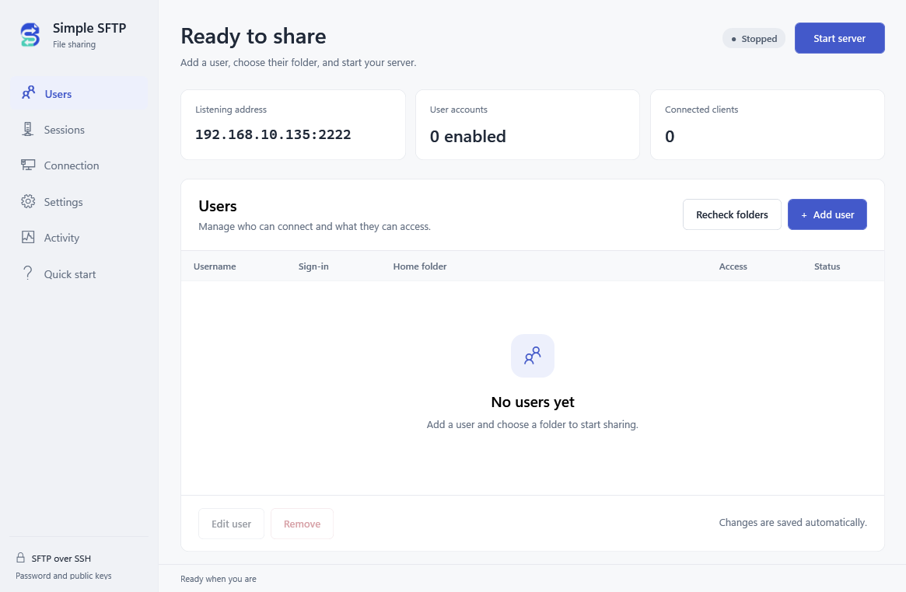

# Simple SFTP

A small Windows desktop SFTP server written in C# and WPF on .NET 10. Create a login, assign an existing folder, and click **Start server**. No database, Windows user accounts, or administrator access needed for the default configuration.



## Run

Open `artifacts/SimpleSftp/SimpleSftp.Desktop.exe` after building, or double-click `run.cmd` to run from source. The application requires the **.NET 10 Desktop Runtime**; building requires the **.NET 10 SDK** on Windows.

```powershell
dotnet run --project src/SimpleSftp.Desktop
```

1. Select **Add user**. Enter a username and an existing folder. Set a password of at least 12 characters, import an OpenSSH public key, or allow both. Disable password authentication for a key-only account. Optionally choose read-only access.
2. Click **Start server**. The app fills in this computer's current network IP automatically, using port `2222` by default.
3. In WinSCP or FileZilla choose **SFTP**, the IP shown in **Connection**, port `2222`, and the account you created. Compare the server fingerprint shown in **Connection** with the client's first-connection prompt.

Or use Windows OpenSSH (replace `SERVER_IP` with the displayed address):

```powershell
sftp -P 2222 username@SERVER_IP
```

The **Connection** page detects an active Ethernet or Wi-Fi address when the app opens and before starting the server. IPv4 is preferred, then usable IPv6; without a usable network address it falls back to `127.0.0.1`. Turn off **Use this computer's network IP automatically** to enter a manual address. Saved manual addresses remain unchanged. Older localhost defaults migrate to automatic detection; existing custom addresses remain manual. To listen on all IPv4 interfaces, enter `0.0.0.0` manually, save, and start. Allow inbound TCP on the configured port in Windows Firewall. Clients connect to this computer's LAN address, not `0.0.0.0`. The app does not modify the firewall automatically.

In **Settings**, choose **Minimize to the system tray** (enabled by default). The preference saves automatically and can be changed while the server is running. Disable it to minimize to the taskbar instead. The server keeps running with either option. With the setting enabled, minimize the app to keep sharing in the background. Its icon appears in the Windows notification area near the clock (it may be under the hidden-icons arrow). Double-click the icon or right-click and choose **Open Simple SFTP** to restore the window. Right-click the icon and choose **Start server** or **Stop server** to control sharing without restoring the window. The menu action follows the current server state and is disabled while a change is in progress. Choose **Exit Simple SFTP** from its menu, or close the main window, to stop the listener and disconnect clients. Stop the server before editing users or connection settings. Home folders are checked at startup, after restoring a backup, and before starting the server. Missing or unavailable paths appear in red with a strikethrough in Users, with an error identifying affected accounts. Edit each user to select a valid folder, or reconnect the drive and select **Recheck folders**. Enabled accounts with unavailable folders prevent startup; disabled accounts remain marked but do not block other users. Accounts can be repaired and saved one at a time. User changes save automatically; connection settings have a Save button and are also saved when starting.

## What is included

- Start/stop controls, tray controls, and connected-client count.
- Live **Sessions** view with usernames, remote addresses, authentication method, connection times, and an operator disconnect action.
- Live uploads/downloads with byte counts, speed, percentage when the size is known, and the latest 200 finished transfers. Unknown-size uploads show bytes and indeterminate progress.
- Optional startup at Windows sign-in, minimized launch, and automatic server start. Windows startup and automatic sharing are disabled by default.
- Password-encrypted backup and restore of accounts, preferences, authorized public keys, and the private server identity.
- Add, edit, disable, or remove password and public-key SFTP accounts. ECDSA P-256/P-384/P-521 and RSA 2048-8192-bit keys with SHA-2 signatures are supported.
- A home folder per account, presented as `/` to the client.
- Read-only or read/write access, enforced by both the SFTP engine and filesystem backend.
- Upload, download, list, rename, delete, create/remove directories, and file attributes through SFTP v3.
- Persistent ECDSA P-256 host identity and a SHA-256 fingerprint.
- PBKDF2-SHA256 password hashes with random salts and 600,000 iterations. Passwords are never saved in plaintext.
- Folder traversal, Windows device name, alternate data stream, symlink, and junction checks. The app's private configuration folder cannot be inside a shared home folder.
- Configurable connection limit (20 by default), five-minute idle timeout, 30-second authentication timeout, and up to five password attempts per connection.
- Authentication throttling across connections: 10 unsuccessful attempts per username and 20 per source address in a one-minute window. Successful attempts refund their reservation. These limits survive listener stop/start while the app stays open.
- Up to eight SSH channels per connection and 128 open file/directory handles per SFTP channel. Closing a channel or handle restores capacity.
- Ordered SFTP responses with bounded queues and cancellation. Slow clients apply backpressure; clients that exceed transport queue limits are disconnected.
- Generic protocol errors keep local Windows paths private; detailed request failures stay in the local activity log.
- Activity view and rotating JSONL logs (5 MB current file plus one previous file).
- SSH shell execution and forwarding are not enabled.

## Configuration and files

Settings, host key, and logs are stored in `%LOCALAPPDATA%\SimpleSftp`:

| File | Purpose |
| --- | --- |
| `settings.json` | Listener options and users with password hashes |
| `host-key.pem` | Private server identity; preserve this between upgrades |
| `activity.jsonl` | Current activity log |
| `activity.jsonl.1` | Previous log, after rotation |

The private directory is restricted to the current Windows account and SYSTEM through its NTFS ACL. Choose a local NTFS directory. To use a different location:

```powershell
.\SimpleSftp.Desktop.exe --data-dir "C:\SftpConfig"
```

Back up settings and the host key together. Deleting the host key generates a new identity at the next start, so clients will report a changed fingerprint. A malformed settings file produces an error on launch and is not overwritten. Settings contain no default accounts or default passwords.

This is an interactive desktop app, not a Windows service. Client public keys use OpenSSH ECDSA or RSA format; Ed25519 keys, certificates, and per-key authorized_keys options are not supported. Quotas and Windows service mode are not implemented. Read/write permission includes deletion. Shared folder access runs under the Windows account running the app. Local administrators and processes that can modify those folders remain trusted; filesystem path checks are not an OS-level sandbox against concurrent local changes or hard links. Network exposure should be evaluated for your deployment; this app has not undergone an independent security audit.

## Public-key access

In Add/Edit user, import a `.pub` file or paste one OpenSSH public key per line (up to 16 per account). Keep the matching private key in the client. RSA uses SHA-2 signatures; legacy RSA/SHA-1 signatures are not enabled. For example, create a supported client key with:

```powershell
ssh-keygen -t ecdsa -b 256
sftp -i "$env:USERPROFILE\.ssh\id_ecdsa" -P 2222 username@SERVER_IP
```

Public-key probes do not sign a user in: the client must prove possession of the private key. Account enabled/read-only restrictions apply to both authentication methods. Remove a key and restart the listener to revoke access; disconnect an already connected session from **Sessions** when needed.

## Startup and backups

**Settings > Startup** controls sign-in launch, minimized launch, and automatic server start. The sign-in setting registers the current app path for the current Windows account; keep the published app in that folder. Automatic server start also applies to manual app launches. These options do not make the app a Windows service: signing out still stops it.

**Settings > Backup and restore** creates a portable `.sftpbak` file encrypted with AES-256-GCM and a key derived from your backup password using PBKDF2-SHA256 (600,000 iterations). Use a password of at least 12 characters and retain it: a forgotten backup password cannot be recovered. Shared files and client private keys are not included. A backup made before the first server start has no host identity to preserve.

Restore requires a stopped server and replaces the current accounts, preferences, and host identity. The application validates and decrypts the backup before replacing files, and rolls back the host key if the settings commit fails. Startup and automatic sharing are turned off after restore. Review users' folder paths, especially when restoring to another computer; unavailable folders can be imported but cannot be shared until corrected. A running server's host identity cannot be replaced through the UI.

## Build and verify

The dependency source is included, so the normal framework-dependent build needs no external NuGet packages.

```powershell
dotnet build SimpleSftp.slnx -c Release
dotnet run --project tests/SimpleSftp.Checks
dotnet run --project tests/SimpleSftp.Checks -- --ui-smoke
dotnet publish src/SimpleSftp.Desktop -c Release --self-contained false -o artifacts/SimpleSftp
```

`build.cmd` creates that publish directory. Distribute the entire directory, not only the `.exe`. A self-contained publish can also be made on a machine with NuGet access by specifying `-r win-x64 --self-contained true`.

The executable check harness uses the installed Windows OpenSSH client for independent, real SFTP tests: 16 MB pipelined binary and empty-file transfers, directories, renames, deletes, rejected passwords, unknown/disabled accounts, read-only enforcement, traversal, restart identity, and shutdown during an active upload. Regression checks cover ordered responses, bounded queues, receive-window exhaustion, cancellation, channel and handle limits, cross-connection throttling, safe error responses, authentication timeouts, disabled accounts with unavailable folders, ECDSA/RSA OpenSSH logins, key-only accounts, key revocation, live transfer/session monitoring, operator disconnect, startup arguments, and encrypted backup integrity and rollback. No test framework packages are needed. A symbolic-link check runs when Windows permits link creation; otherwise it reports a skip. The UI smoke mode renders screenshots and exercises start and close behavior using isolated test settings. Check artifacts stay under `artifacts/`.

## Source layout

- `src/SimpleSftp.Core` — configuration, password hashing, storage restrictions, filesystem guards, and SFTP lifecycle.
- `src/SimpleSftp.Desktop` — WPF interface and dialogs.
- `tests/SimpleSftp.Checks` — independent protocol checks and UI smoke checks.
- `vendor/FxSsh` — MIT-licensed SSH/SFTP implementation with its original license.

See [THIRD-PARTY-NOTICES.md](THIRD-PARTY-NOTICES.md) for dependency provenance and local compatibility changes.
